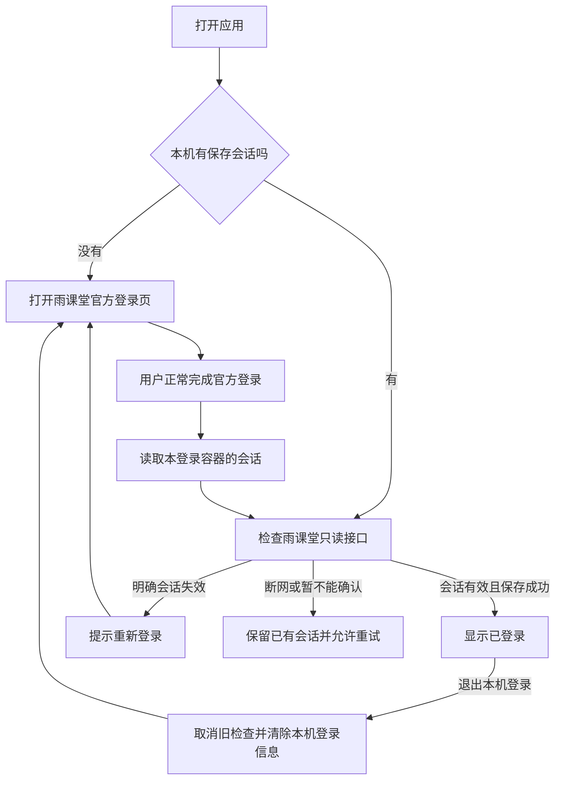

# 第一段客户端功能：安卓雨课堂登录

日期：2026-10-29。状态：`apps/client` 登录初版已实现，26 项行为测试、静态分析及 ARM64 开发 APK 核验通过；主人随后反馈四个交付步骤均已在手机上通过，包括官方登录、重开恢复和本机退出。该结果为用户报告，未独立读取设备或会话；具体微信跳转方式和断网恢复尚未单独报告。窄屏显示调整已保留，按主人要求随下一个功能版本查看，不为此重复交付安装包。[手机验收与代码阅读](client-app-login-acceptance.md)。

## 1. 这轮做成什么

在安卓应用中使用雨课堂官方登录页完成正常登录，取得当前登录容器的会话，通过只读接口确认有效，再安全保存在本机。重新打开应用可以恢复并检查，明确失效时引导重新登录，退出时清除本机登录信息。

测试手机由主人提供信息：**一加 Ace5 至尊版，Android 16**。这是用户报告，尚未通过设备连接独立核对。现有 Flutter 3.47.8／Dart 3.13.7、Java 17、Android SDK 36 已通过上一轮构建验证。

同机完成官方登录、并让结果回到应用自己的登录容器，是这轮必须实测的未知点。显示二维码、打开微信、或系统浏览器显示已登录，都不能单独证明应用已取得可用会话。

## 2. 主人先看这张流程图

这张图里需要理解三个判断：**拿到会话不等于会话有效；网络失败不等于会话失效；退出后旧请求不能重新恢复登录状态。**

## 3. 推荐验收标准

| 情况 | 软件应表现为 | 验收方式 |
| --- | --- | --- |
| 首次安装 | 显示未登录，可进入官方页面 | 主人实际操作 |
| 正常登录 | 应用取得当前容器会话，独立只读检查通过且保存成功后才显示已登录 | 真机登录与脱敏检查结果 |
| 关闭后重开 | 读取安全存储并重新检查；有效后恢复已登录 | 主人退出重开 |
| 明确会话失效 | 显示需要重新登录，提供入口 | 合成用例；实际失效响应另作对照 |
| 断网、超时、服务器异常 | 显示暂时无法检查，保留已有会话，允许重试 | 自动测试与真机断网测试 |
| 退出本机登录 | 清除会话、内存和本应用登录容器的 Cookie；重开后不自动恢复；旧检查晚返回也不能恢复 | 自动竞态用例与主人操作 |
| 重新登录或取消 | 新会话验证并保存成功才替换旧记录；取消不覆盖原有效记录 | 合成用例与真机操作 |
| 安全存储失败 | 明确提示保存／清除未完成，允许重试，不假报保存或退出成功 | 注入失败的自动测试 |

**主人已确认：“退出本机登录”和“停止云端监听／解除云端绑定”分开。** 关闭软件不影响云端的既定原则保留；这轮按钮明确叫“退出本机登录”。如果希望退出账号也停止云端，需要另外设计云端停用步骤，不能只删除本机数据后声称已停止。

官方登录可能需要微信正常确认。尽量在应用内完成；只有官方流程要求时才由用户主动打开微信。如果结果落在系统浏览器而没有回到本应用的 Cookie 存储，记录具体阻点，再讨论支持路线；不默认能够跨应用读取 Cookie，也不将手动复制会话当作已实现自动登录。

## 4. 这轮怎么分工

| 工作 | 负责人 |
| --- | --- |
| 确认上述行为，决定本机退出与云端停用是否分开 | 主人 |
| 解释流程与方案、实现、自动测试、排错、构建 | 我 |
| 在官方页正常登录、核对微信账号、试用重开／断网／退出 | 主人 |
| 说明测试证据及未验证内容，整理改动 | 我 |
| 实现后一起阅读“会话失效”和“网络错误”两个处理分支 | 共同完成 |
| 尝试一个小改动，例如失效分支的提示或校验规则，并运行相应用例 | 主人练习，我给提示与审阅 |

这轮先理解输入、状态变化和失败处理，不要求先读完插件源码。能看懂、能解释、能修改和真机运行通过分别记录。

## 5. 关键代码将放在哪里

已从已有 Flutter 验证模板建立 `apps/client/`，作为客户端第一段功能的起点。使用现有工具链，保留此前环境验证源码与 APK。下表对应当前主要实现文件。

| 拟新增文件 | 职责 | 主人优先阅读程度 |
| --- | --- | --- |
| `apps/client/lib/main.dart` | 启动应用、连接页面与会话控制器 | 看懂入口 |
| `apps/client/lib/login_page.dart` | 登录页、官方网页容器、检查／重试／本机退出按钮 | 看懂按钮触发什么 |
| `apps/client/lib/auth/session_controller.dart` | 恢复、检查、重新登录、退出的状态变化，处理异步结果过期 | **本轮重点阅读** |
| `apps/client/lib/auth/session_client.dart` | 只读会话检查、响应分类与有上限的等待 | 看懂成功、失效、暂不可用的区别 |
| `apps/client/lib/auth/session_store.dart` | 安全存储读取、替换与删除 | 看懂保存内容及清除时机 |
| `apps/client/lib/auth/cookie_reader.dart` | 从当前容器提取指定会话，保留 Cookie 值中的等号 | 理解用途，具体适配按需读 |
| `apps/client/android/.../MainActivity.kt` | 一小段固定站点的 Android Cookie API 适配 | 本轮不要求深入原生框架 |
| `apps/client/test/` | 状态、网络分类、退出竞态和 Cookie 解析用例 | 看懂每项在保证什么 |

另涉及 `pubspec.yaml`／锁文件与 Android Manifest。开发包拟使用 `top.frewily.rainclient.dev`，名称为“雨课堂管理 · 开发版”；未来正式版本的发布签名单独准备。这轮不覆盖原环境验证包。

## 6. 已核对的依赖提案

最初提案保留为[拟用 pubspec](verification/android-login-probe/proposed-pubspec.yaml)。主人批准后，以下四个直接依赖已安装；实际版本和档案摘要与提案一致，平台实现和基础传递依赖已锁定到 `apps/client/pubspec.lock`。

| 依赖 | 版本 | 用途与已核对条件 |
| --- | --- | --- |
| `webview_flutter` | 4.14.1 | Flutter 官方网页容器，声明支持 Android／iOS／macOS；要求 Flutter ≥3.38、Dart ≥3.10，现有版本满足 |
| `webview_flutter_android` | 4.14.1 | 显式固定 Android 实现，并使用必要的平台设置；最低 API 24、Java 17、跟随现有 compileSdk |
| `flutter_secure_storage` | 11.2.0 | 本机加密会话存储；最低 Android API 23，默认 RSA OAEP 包装密钥与 AES-GCM 加密；本轮不开启生物识别 |
| `url_launcher` | 6.3.3 | 仅在用户主动操作且官方登录确需跳转时打开受限的官方微信链接；本身不能保证登录结果回到原容器 |

已核对的候选平台实现还包括 `webview_flutter_wkwebview` 3.27.2、`flutter_secure_storage_darwin` 0.4.3。平台支持声明不等于 Mac 已编译通过；Mac 等完整 Xcode 就绪后单独验收。若安装或构建要求额外 SDK、CocoaPods、CMake、未列插件或其他重大版本，先说明新增范围。

新增 Pub 包和原生编译依赖放入现有隔离缓存，继续使用既有 SDK／JDK；不修改终端启动文件。实际下载量由解析和构建记录，不预先承诺尚未测量的体积。

2026-10-29 根据主人要求只读核对[本机已有工具](verification/client-s0-existing-toolchains-20261029.json)：通用目录 Flutter 3.47.8／Dart 3.13.7 和 Android SDK 已可用。检查时 PrivateVault 的独立 3.47.5 源码尚未缓存 Dart／工具快照；该项目未修改。随后主人明确允许复用现有工具、新增已列插件并实现。构建发现两个 JNI 传递库默认 API 35，本项目用 `finalizeDsl` 统一到已有 API 36；CMake／Ninja 又从现有 REA 工具环境中找到并核对版本及 ARM64 架构，通过忽略的本机配置引用。最终没有安装额外 SDK、CMake、Ninja 或 Java，未修改供应商源码及 REA 项目。

## 7. 会话和接口的具体边界

- 官方登录页为 `https://changjiang.yuketang.cn/web`；Cookie 读取只针对本应用当前容器中这个固定 HTTPS 站点的 `sessionid`。不让网页 JavaScript 调用原生会话读取，也不提供任意站点参数。
- 独立检查只调用 `GET https://changjiang.yuketang.cn/v2/api/web/userinfo`，仅附带本次会话。该接口与既有 Python `function/user.py`、此前 Mac 原生验证相同。
- HTTP 200 还要检查 JSON 中是否有有效用户记录。具体失效响应／业务码需用无会话、合成失效会话和正常会话作只读对照后确认；不预设所有 403 或格式异常都表示过期。
- 网络、超时、服务异常与明确失效分开。检查有上限、限制并发；不定时高频请求个人信息接口。
- 只在新会话检查通过且保存成功后替换旧记录。退出／取消使旧请求失效，防止晚到的结果恢复旧登录。
- 会话进入 Android Keystore 支持的应用私有加密存储和临时内存；使用独立命名空间。关闭开发应用自动备份，避免恢复后密钥与密文不匹配；存储异常显式报告，不自动静默重置。
- 保存成功、取消或退出时清理本应用登录容器的 Cookie，避免安全存储之外遗留长期会话。清理操作的范围是当前仅用于雨课堂登录的应用 WebView 存储，不退出微信或系统浏览器账号。
- 用户界面和日志只显示安全状态，不输出 Session、Cookie 原值、授权码或完整个人信息响应。真实会话不进入 GitHub、Cloudflare 或仓库；本轮也不进入课堂、签到或触发监听。

## 8. 一个已发现的插件边界

`webview_flutter` 的 4.14.1 正式 API 确认提供 `getCookies`，Android 实现调用原生 `CookieManager.getCookie`，可以经应用的本机 API 读取本登录容器，而不依赖网页读取 HttpOnly 值。

进一步检查 Android 4.14.1 固定源码发现，Dart 包装层使用 `cookie.split('=')` 后取最后一段，带等号的 Cookie 值存在截断边界。因此这轮拟让一小段 Android MethodChannel 仅返回固定雨课堂站点的本应用 Cookie 文本，在可测试的 Dart 适配中按第一个等号解析，并只选 `sessionid`；包含等号、多 Cookie、无会话、重复会话等情况都要覆盖。无需修改已发布插件，也不读取其他应用的 Cookie。

固定版本与源码证据、包校验值见[准备记录](verification/client-s0-android-login-preparation.json)。安全存储的发布标签已从迁移后的官方仓库核对；没有把默认开发分支当成发布能力。

## 9. 实现后的退出条件

先通过状态与 Cookie 解析测试、静态分析和 APK 构建；之后由主人在上述手机完成正常登录、恢复、断网、取消、重新登录和本机退出。无真实会话时先用合成存储标记检查安全存储与清除；真实会话只用于已列只读接口。

每一步分别记录“代码／自动测试”“主人报告”“独立设备观察”，不互相替代。Mac、GitHub／Cloudflare 客户端绑定、云端会话写入、公开跨账号授权及正式发布继续作为后续切片。

本机退出行为和安装／实现范围均已确认，电脑端实现、测试和构建现已完成。实际执行与构件证据见[运行记录](verification/client-s0-android-login-runtime.json)，源码摘要见[源码证据](verification/client-s0-android-login-source.json)。开发包采用 Release 编译、ARM64 分包和开发签名，16,541,076 字节；不冒充正式发布签名或真机登录已通过。手机验收后，再共同阅读状态分支并由主人选择一个小改动练习。
