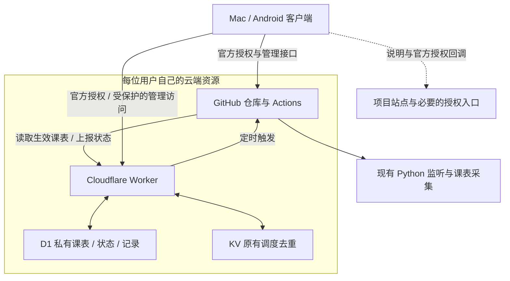

# Mac 与 Android 管理客户端方案（第一版）

日期：2026-10-25；验证进展更新于 2026-10-30。状态：安卓雨课堂登录与 GitHub 连接已有主人真机反馈通过；0.3.0 已将 Cloudflare 连接、具体测试部署、一次空任务与结果查看接入同一包，98 项本地测试和包核验通过，等待主人走完真实手机／云端测试链路。阶段 0 和真实业务改造仍有未完成项。

代码核对基线：`e2a16afbc2f58c0ab524491af0e5a738cf087b92`。本文结合当前代码与本轮逐项讨论编写；官方文档支持的能力与本项目已经验证的能力分别说明。

## 1. 目标与已确定的边界

将目前分散在 GitHub、Cloudflare 和配置文件中的操作集中到软件中，让合工大同学能完成授权、部署、配置、课表调整和运行状态查看。

软件是云端管理客户端：监听仍运行在用户自己的 GitHub Actions 上，用户自己的 Cloudflare Worker 负责调度。关闭软件不影响已经启用的云端运行，Python 和 OCR 不需要安装到手机中。

| 事项 | 已达成的决定 |
| --- | --- |
| 用户范围 | 第一版完整支持合工大；其他学校留待后续 |
| 平台 | Mac、Android；两端都属于第一版交付目标 |
| 云资源 | 每位用户使用自己的 GitHub 仓库和 Cloudflare 账号 |
| 绑定方式 | 优先网页登录授权，不要求用户手动创建、复制云平台 Token |
| 外部页面 | 能在软件内完成的留在软件内；官方登录、授权可以打开系统授权页面，完成后自动返回 |
| 授权备选 | 手动 Token 仅作为后续讨论的备选；遇到困难时不自行改成此路线 |
| 雨课堂会话过期 | 第一版允许重新登录，由软件更新云端配置；自动续期是后续改进 |
| 状态查看 | 显示任务进度、课堂监听状态、关键事件和最近上报时间；过期状态显示“未知” |
| 通知 | 第一版提供软件内查看和可选邮件；系统推送后续再做，届时邮件仍为可选项 |
| 隐私 | 源码公开；课表、详细运行记录、监听状态默认私有 |
| 费用 | 免费额度优先，软件说明额度与超额影响，不自动开通付费套餐 |
| 发布 | 通过 GitHub Releases 发布 Mac 安装包、Android APK，不考虑应用商店 |
| 课表编辑 | 支持修改某次课的时间、暂停某次监听；同步时保留手工调整 |
| 项目域名 | 项目方拥有 `frewily.top`；可规划子域名，尚未配置 DNS 或部署网站 |

现有课堂处理逻辑继续复用。客户端化不包含新增题目处理策略、重新设计提交逻辑或改变 OCR 提前初始化的既定选择。

## 2. 使用流程

首次使用的目标流程：

1. 从 GitHub Releases 安装软件。
2. 点击“绑定 GitHub”，完成官方授权后返回软件。
3. 点击“绑定 Cloudflare”，完成官方授权，选择自己的账号。
4. 软件检查是否已有对应仓库和部署：新用户创建，老用户先展示接管清单。
5. 在软件中完成雨课堂登录。自动取得可供现有程序使用的会话，是需要先验证的目标能力。
6. 填写合工大教务配置，选择需要监听的课程；其他现有配置通过表单填写。
7. 软件创建私有存储、部署 Worker、配置 Actions Secrets，获取并预览课表。
8. 显示配置检查结果，由用户点击“启用自动监听”后启用调度。
9. 日常在软件中查看课表、调整某次安排、查看监听状态与运行历史。
10. 登录过期时显示重新登录入口，完成后更新云端凭据。

账号注册、官方验证和第三方凭据申请中无法由软件代办的步骤，提供明确引导。这里的“统一配置”不意味着软件能绕过平台的注册、验证或授权要求。

第一版不要求用户编辑 Worker 源码、手动填写一批 Secrets，或自行安装 Python、Node、OCR 环境。

## 3. 页面范围

| 页面 | 第一版内容 |
| --- | --- |
| 总览 | 部署是否就绪、今日安排、任务进度、监听状态、最近上报时间、需处理的问题 |
| 课表 | 合工大课表、监听课程选择、单次改时间、单次暂停、同步结果与冲突提示 |
| 运行记录 | 按运行和课堂查看关键事件、开始结束时间、重连情况、安全错误说明 |
| 部署与连接 | GitHub / Cloudflare 绑定、部署步骤、失败重试、已有部署接管、版本信息 |
| 设置 | 雨课堂重新登录、教务及现有第三方配置、可选邮件、隐私与免费额度说明、退出绑定 |

页面直接使用“等待启动”“正在准备环境”“已收到课堂消息”“需要重新登录”等说明。KV、D1、Secret 等实现名称放在必要的高级详情中。

## 4. 推荐架构

建议使用 Flutter 开发客户端，共用大部分界面和业务代码。系统授权、雨课堂登录容器、安全存储、回调和安装包仍需分别验证 Mac、Android 的适配。

推荐增加用户自己账号下的 D1，保存需要查询、版本校验和更新的私有课表与运行事件。它是 Cloudflare 托管存储，不要求用户再维护数据库服务器。原 KV 的去重职责先保留，不顺带重做分布式调度。

项目站点可暂定为 `rain.frewily.top`，这是待确认的子域名示例。网站承载介绍、下载说明和官方要求的项目身份信息，不集中存放同学的课表、SESSION、教务密码或运行记录。

GitHub 的授权流程是否还需要一个由项目方维护的轻量授权中转服务，必须在阶段 0 验证后明确。不能从“域名已有”直接推导出“无需任何公共服务”，也不把开发者的 OAuth 密钥打包进客户端。

## 5. 与当前代码的差异

| 当前事实 | 客户端化需要补充的能力 |
| --- | --- |
| Worker 的仓库地址是源码常量 | 部署时绑定用户仓库、分支和工作流，避免新用户误用维护者的目标 |
| Worker 从公开 Raw 地址读取课表 | 管理模式从用户私有存储读取生效课表 |
| 课表工作流提交 JSON、ICS 到仓库 | 管理模式将课表上传到私有存储，不提交个人课表和公开日历 |
| Python 读取仓库中的本地课表文件 | 启动时获取经过鉴权的课表快照，保留现有窗口计算逻辑 |
| 课表模式由两项教务 Secret 是否存在决定 | 明确区分“使用私有课表”和“如何采集教务课表” |
| 项目只读取用户提供的 SESSION | 验证软件内官方登录并取得可用会话，失效后重新登录并更新 Secret |
| 课堂报告只在邮件配置完整时创建 | 最小状态上报独立于邮件开关，保留邮件作为单独输出方式 |
| 控制台会输出课程、题目、链接和部分异常正文 | 公开输出收敛为安全的任务进度，个人详情进入受保护记录 |
| 线程监督能上报终止异常 | 补充连接事件、最近消息时间和状态新鲜度，保留原监督机制 |

涉及的现有代码主要包括：

- [Worker](../cloudflare/worker.js)、[监听工作流](../.github/workflows/python-app.yml)、[课表工作流](../.github/workflows/course-schedule.yml)。
- [课表模块](../function/course_schedule.py)、[主入口](../start.py)、[监听线程](../function/listening_socket.py)、[线程监督](../function/listener_supervisor.py)。
- [课堂报告](../util/listening_report.py)、[配置](../config.py)。

这已经超过几十行的维护优化，是一个新客户端加云端适配的开发任务。建议保持原命令行使用方式可用，通过显式管理模式接入新能力，分阶段验证，避免先重写原项目。

## 6. 授权：先验证，再确定实现

### 6.1 Cloudflare

官方文档已明确支持第三方 OAuth，以及适用于桌面、手机的 Authorization Code + PKCE；客户端无需保存开发者的 Client Secret。公开授权客户端还需要项目方完成域名所有权验证。

仍需在本项目中验证：公开客户端能否由非项目方账号授权、两端回调是否正常、所需 API 权限是否覆盖 Worker / KV / D1 / Secrets / Cron，以及令牌刷新和撤销后的行为。

2026-10-27 已完成本人账号的私有客户端验证：Authorization Code + PKCE S256、无 Client Secret，令牌交换与只读用户信息请求均返回 HTTP 200，实际权限仅 `user-details.read`；撤销访问令牌后，同一接口返回 HTTP 403。本次未请求 `offline_access`、未返回刷新令牌，刷新仍待验证。该结果不覆盖资源管理、公开跨账号授权、Flutter 或 Android，详见[阶段 0 首轮验证记录](client-app-stage0-verification.md)。

2026-10-28 又通过独立私有管理客户端完成本人账号中的自动部署：五项实际权限为 D1 Write、Workers Admin、Workers KV Storage Write、Memberships Read、User Details Read。程序自动创建 Worker／KV／D1、配置 Secret 和绑定，真实 Worker 请求确认读到两项合成数据。测试后 Secret、KV、D1 已删除，空 Worker 入口关闭且绑定清空，令牌撤销及随后 403、公开入口 404 均已核验。该结果支持软件内自动部署；公开跨账号授权、Cron、Cloudflare 刷新仍单独验证。权限扩大经主人另行批准；三轮排查与边界见[Cloudflare 管理验证](client-app-cloudflare-manager-probe-plan.md)。

这些是项目方统一准备的授权应用，不让每位同学自己注册一个开发者应用。

### 6.2 GitHub：登录授权与离线调度分别验证

客户端需要 Fork / 接管仓库、启用 Actions、写入 Secrets、查看运行和维护版本。Worker 还需要在客户端关闭后继续触发 Actions。

两组需求不能简单等同于“用户登录过一次”。官方文档中的 GitHub App installation token 一小时过期，不能直接把它保存为 Worker 的长期调度凭据。

阶段 0 需要比较官方可用的 OAuth 原生客户端流程、需要安全中转的网页授权流程，以及 GitHub App 方案，给出一个具体选择及权限清单。评估至少覆盖：

- 设备关闭后如何继续取得有效调度权限；必要刷新在哪里完成。
- 是否能限制到目标仓库和必要操作；OAuth 较宽权限与 GitHub App 较细权限的取舍。
- 是否依赖项目方持续提供中转或签发服务，其故障会影响哪些操作。
- 用户撤销授权后，客户端和 Worker 如何明确停止并提示。

推荐优先保留“用户资源自有、无需公共服务持续代管个人运行”的结构；最终机制由验证结果决定。若需要公共授权服务，应先展示维护责任和权限范围，再决定实施，不把它隐含在“一键绑定”里。

这与雨课堂“第一版不要求自动续期”是两件事：GitHub 的离线触发授权必须在第一版可正常工作。

2026-10-26 已实测通过 GitHub 设备授权和无 Client Secret 的立即刷新：实际只授予 `read:user`，新令牌可读取同一账号，旧访问令牌返回 401。该证据验证了刷新机制，不覆盖仓库管理权限、真实 dispatch 或 Worker 环境执行；详见[阶段 0 首轮验证记录](client-app-stage0-verification.md)。

2026-10-27 已完成 GitHub App 调度身份的本机实测：仅 `Actions: write` 与基础 `Metadata: read`，实际只授权一个空测试仓库；无 Client Secret 的立即刷新成功，旧访问令牌返回 401。该仓库唯一一次空任务成功运行，未授权对照仓库的触发请求返回 403，运行数为 0。因此，优先沿 GitHub App 设备授权用户令牌路线继续验证云端调度，后续再验证客户端管理身份。证据与清理边界见[阶段 0 记录](client-app-stage0-verification.md)和[权限清单](client-app-permissions-and-next-probe.md)。新用户自动 Fork 另有安装范围约束，首版可能仍需在 GitHub 官方 Fork 页完成一次确认，不能把完全自动 Fork 写成已经解决。

同日已进一步通过独立 Cloudflare Worker 的真实请求验证：本机不刷新，Worker 内无 Client Secret 刷新返回 200、旧令牌 401，并触发唯一一次新的空任务成功运行。成功轮新令牌撤销后自动检查为 401；2026-10-28 再次确认测试公网入口 404并停止本地程序。该证据只覆盖一次请求内的立即刷新与触发，尚未验证关闭客户端后的长期 Cron、轮换令牌持久保存、并发刷新或丢失响应恢复；详见[Worker 实测摘要](verification/client-s0-worker-runtime.json)。

2026-10-28 已进一步通过独立管理 App 的真实验证：只授权同一个空测试仓库，使用设备授权用户令牌完成 Actions 开关关闭与恢复、普通配置及工作流创建／回读、随机 Secret 的公钥加密写入，以及唯一一次任务实际读取 Secret 并成功。测试文件和 Secret 删除后，文件树与原基线一致；成功轮令牌独立检查为 401，进程退出、临时加密依赖环境已删除。该结果支持软件内自动配置指定仓库，仍不覆盖自动 Fork、跨账号公开安装或已有代码的升级冲突处理。详见[管理实测与收尾](verification/client-s0-github-manager-runtime.json)。

2026-10-29 已把该私有管理 App 的设备授权接入安卓客户端，完成账号／已授权仓库识别、独立安全保存、恢复、仓库选择和本机清除。66 项本地测试及开发包核验通过，尚未发起本轮真实授权；手机验收与范围见[GitHub 绑定](client-app-github-binding.md)。本段网络层只含账号／安装／仓库元数据读取及 OAuth，不包含仓库或部署写操作。原调度 App 未改动，公开跨账号与长期云端调度继续分别验证。

2026-10-30 主人报告该功能四个交付步骤全部通过，包括手机官方授权、账号与原测试仓库识别和选择、重开恢复。该记录是用户反馈，未独立读取手机或授权；不将其外推为真实凭据更新或云端长期调度通过。后续先接入[Cloudflare 账号绑定](client-app-cloudflare-binding.md)，暂不创建或修改云资源。

随后按主人要求调整交付粒度，完成[0.3.0 整段测试部署功能](client-app-test-deployment.md)：复用原 Cloudflare 应用，把官方授权、账号检查、具体清单、合成 Worker 部署、原空仓库单份工作流创建、一次触发和结果查看连起来。真实写入由主人在手机内核对本次清单并确认后执行；助手尚未执行本轮云端操作。此包暂不分配 KV／D1、写 Secrets 或接入真实课程，不把本地模拟通过当作已完成真实云端部署。

2026-11-01 已完成[安卓真机测试部署闭环](client-app-android-callback-fix.md)：修复后台授权返回与默认 Python 请求标识，0.3.4 的 113 项本地测试通过；真实 Cloudflare 连接、手机部署合成 Worker／工作流、任务 41286937681 首次运行成功、手机显示相同结果和关闭公网入口均已核对。首轮失败单独保留并清理，没有重发同一计划；成功轮工作流及关闭的 Worker 保留。下一段可聚焦真实配置／课表与监听接入，Mac、长期调度、自动 Fork、公开跨账号发行继续分别验证。

### 6.3 雨课堂登录

目标是在软件中的官方登录容器完成正常登录，取得仅属于该登录会话的凭据，验证后写入用户自己的 Actions Secret。

当前 `apps/client` 已实现安卓官方网页登录、固定站点 Cookie 读取、独立只读有效性检查、安全保存和本机退出；主人已反馈登录、重开恢复及退出通过。该反馈不等于已验证云端 Python 使用、具体微信跳转路径或 Mac Flutter 集成。系统浏览器登录成功并不自动意味着客户端能读取它的 Cookie。

2026-10-26 已完成 Mac 原生验证：独立 WKWebView 中由用户扫码登录，原生程序取得临时会话，独立 HTTP 客户端仅携带该会话请求只读个人信息接口，返回有效用户记录。临时会话已清理。该结果尚不覆盖 Flutter 插件集成、Android 或自动续期，详见[阶段 0 首轮验证记录](client-app-stage0-verification.md)。

验证可以使用个人信息等只读接口确认会话，不以签到、启动真实监听或其他业务操作作为登录检查。若无法完成，不默认为“用户以后手动抓包”，而是记录阻塞点，再讨论可接受的备选。

### 6.4 凭据与管理访问

本机凭据使用 Mac 钥匙串、Android Keystore 支持的安全存储。GitHub Secrets 和 Worker Secrets 只展示配置状态，不设计“读回旧密钥原值”的功能。

客户端管理访问和 Actions 运行访问分开授权。可优先验证这样一种无需集中保存用户令牌的管理方式：客户端使用 Cloudflare OAuth 访问自己账号的 D1，登记短期管理会话的摘要；Worker 校验会话后开放管理接口。会话原值留在本机，不用把管理员长期密钥写进公开源码，也不需要第二台设备读回已有 Secrets。具体权限、会话过期和撤销规则在阶段 0 确定。

Actions 使用单独的实例运行凭据，只允许取得所需课表、上报当前运行。运行接口限定实例、仓库和运行标识；不复用现有 `/test` 密钥作为通用管理员凭据。

## 7. 私有课表与手工调整

采用三层数据：教务来源课表、用户手工调整、生效课表。调度和 Python 使用生效课表，界面同时说明哪些课次被调整过。

规则如下：

1. 同步教务课表时更新来源层，保留手工调整，不直接覆盖编辑后的最终文件。
2. 每次调整关联学期和原始课次标识；修改时间后仍能追溯原课次。
3. 第一版支持对尚未启动的单次安排改时间、暂停、撤销调整。
4. 新学期不自动套用旧学期调整。来源课次被删除或无法匹配时，保留冲突记录并提示用户处理，避免调整错绑。
5. Mac 与 Android 同时编辑时使用版本校验；旧版本写入被拒绝，界面刷新后再处理。
6. 发布生效课表时整体校验日期、时间、课程及版本；失败时保留上一份有效版本。
7. Worker 和 Actions 使用同一份版本化课表。排队中的任务在正式启动前重新判断安排是否已取消或改期，避免盲用过期版本。
8. 已启动任务保留启动时的课表版本和窗口语义。修改课表不暗中取消或重启当前任务，界面明确说明生效范围。

沿用现有监听窗口和补触发规则，不因为刷新课表而清空去重记录，也不声称现有 KV 能保证恰好触发一次。

合工大采集器继续复用。提供明确的“重新获取课表”操作，按需要强制采集来源层；日常仍可使用当前学期缓存。网络、验证码或学校接口异常时，保留已有有效课表并给出简明原因。

管理模式下，公开 JSON、ICS 不再作为个人课表载体。原有独立日历订阅能力后续如需保留，应另设计受保护的订阅方式。

## 8. 监听状态与运行记录

状态至少区分两层：

| 层次 | 示例 |
| --- | --- |
| Actions 任务 | 等待启动、准备环境、程序启动、已完成、失败、取消 |
| 课堂监听 | 检查课程、等待课堂、连接中、已收到课堂消息、重连中、正常结束、异常退出、状态未知 |

心跳只证明上报程序最近还能运行，不证明所有线程都在推进。连接状态、监听线程状态、最近有效课堂消息时间和进程心跳分别记录；没有新题或课堂消息，也不能直接认定监听故障。

每条上报带实例 ID、run ID、运行尝试编号、课堂标识（如适用）、事件编号和时间。后台按运行及课堂保存，拒绝乱序旧状态覆盖新状态，重复事件幂等处理。

建议起始参数（属于设计默认值，尚未经过用量或延迟验证）：

- 客户端在前台约每 15 秒刷新；退到后台后停止高频刷新。
- 运行程序约每 60 秒上报心跳；关键连接、重连、结束、失败事件及时上报。
- 运行中超过约 180 秒未收到上报，显示“状态未知”和最后上报时间；不据此自动重启监听。
- 详细事件保留 7 天，运行摘要保留 30 天；当前学期课表与手工调整另行保存。

安装依赖阶段可以读取 Actions 的步骤状态。真正的课堂状态必须来自程序事件，不能用任务绿灯或存活状态代替。

状态上报采用有界队列、超时和有限重试；上报故障不无限等待，也不阻断原课堂流程。课表鉴权或校验失败则明确停止启动，不回退到公开课表。强制取消或 Runner 终止可能没有结束事件，此时结合 GitHub 结果与上报新鲜度展示，不能补写“正常下课”。

第一版详细记录以任务与监听事件、安全错误类型和已有结果摘要为主，不做完整控制台实时镜像，不扩大采集题目正文、图片链接或第三方原始响应。

## 9. 公开源码与私有数据的具体边界

| 数据 | 建议存放位置 |
| --- | --- |
| 源码、界面资源、配置模板、版本说明 | 公开仓库与 GitHub Releases |
| 官方授权取得的本机凭据 | 操作系统安全存储 |
| SESSION、教务凭据、现有第三方密钥、可选邮箱授权码 | 用户自己的 GitHub Secrets，按现有用途注入 |
| Worker 运行凭据 | 用户自己的 Worker Secrets；按角色限定访问 |
| 课表、手工调整、运行状态、私有事件记录 | 用户自己账号下的 D1，经授权访问 |
| 调度去重 | 用户自己的 KV |
| 项目介绍和授权应用身份信息 | 项目方域名下的站点 |

公开 Actions 只输出允许公开的阶段说明、错误类型和关联编号。不能依赖 GitHub 对 Secret 原值的自动遮挡来保护课程、题目、URL 或异常正文。

实施时需要审查整个业务输出链，包括第三方库、退出错误和临时文件处理。详情上传失败时，不改为输出到公开日志，也不上传成公开仓库的附件或构建产物。基础状态采集独立于邮件是否启用。

新用户启用前替换继承的示例课表，避免误用维护者课程。老用户接管时说明已有公开课表和历史日志的范围：停止新增公开信息不等于删除历史内容，历史清理需要单独处理。

## 10. 部署、接管和多设备

部署按可恢复的步骤执行：检查权限 → Fork / 识别仓库 → 创建或识别私有资源 → 部署 Worker → 配置凭据 → 获取课表 → 只读检查 → 用户启用 Cron。

每一步记录实例与资源标识，重试时先检查已有结果，避免网络中断后重复 Fork、重复建 Worker 或注册多个 Cron。发现同名但不属于本实例的资源时停止并提示，不直接覆盖。

旧部署接管先显示差异，再按确认迁移。切换时处理原 Cron，避免新旧调度器同时工作；没有明确归属的资源不自动删除。

第二台设备绑定相同 GitHub、Cloudflare 后，识别已有实例，读取同一套课表与记录，不另建一套部署。已有 Secrets 显示“已配置”；需要修改时重新填写或重新登录，不尝试读回原值。

`/test` 会真实触发 Actions，不能用作部署健康检查。部署检查采用鉴权、配置验证和只读预览；需要真实运行时必须显示操作含义，由用户主动启动。

版本维护建议采用“发现更新 → 展示变更 → 用户确认后升级”，并记录客户端版本、云端接口版本和部署版本。版本不兼容时明确提示，不自动覆盖用户修改或在上课中升级。第一版可先从 Releases 下载新版客户端；静默自更新不作为首版要求。

## 11. 代码组织建议

建议先放在同一仓库，便于客户端、Worker 和 Python 的接口一起验证；不在当前阶段新建远程仓库。可新增 `apps/client/` Flutter 工程及独立的云端管理、状态上报模块，现有代码按职责接入。

第一版不以拆分全部 Python 模块、改目录名称或引入复杂服务框架为前提。D1 的新增职责限定为客户端所需的私有数据，不将原课堂业务整体改造成数据库应用。

管理模式明确选择私有数据源；兼容旧用法时需要显式模式边界。管理模式不能因为配置缺失而使用维护者仓库地址或公开示例课表。

## 12. 实施阶段与退出条件

### 阶段 0：验证三方授权和离线运行

先做最小验证，不先投入完整 UI。

- 两端验证 GitHub 官方授权与回调，列明 Fork、Secrets、工作流及运行查询所需权限。
- 验证客户端关闭后 Worker 的 GitHub 调度授权如何保持有效，输出具体机制及依赖。
- 验证 Cloudflare 公开 OAuth 的跨账号授权、PKCE、资源管理 API 和短期管理访问。
- 两端验证雨课堂正常登录、取得会话、只读有效性检查和重新登录替换。
- 确认 Mac 安装包签名、公证是否有现成条件；列出开发者成本与安装体验差异。

交付：每项的实际证据、失败条件、最终授权机制、精确权限清单、是否需要公共授权服务，以及是否可以继续进入完整开发。

退出条件：三个绑定环节和离线调度都有可实现、可解释的路线。没有通过时先解决对应条件，不把手动 Token / 抓包备选伪装成已经完成的 B 方案。

本阶段涉及的 SDK 安装、授权应用注册、DNS、测试资源创建和云端验证，需要先列明具体操作再执行。当前方案编写不包含这些操作，也不启动真实课堂流程。

### 阶段 1：建立私有云端数据与接口

实现 D1 数据结构、受保护的管理 / 运行接口、版本化课表、运行记录保留和显式管理模式；Worker 的目标仓库等配置移出固定个人值。

验收重点：未授权访问失败、运行身份不能改管理员配置、错误课表不替换旧版本、并发修改可识别、日志不会泄露私人数据。使用合成课表和模拟事件验证。

### 阶段 2：客户端授权、部署和配置

完成 Flutter 两端基础工程、官方授权、安全存储、部署向导、Secrets 表单、已有实例接管和恢复失败步骤。

验收重点：全新账号按引导完成、权限不足可解释、中断后可继续、第二台设备能识别已有部署、配置不需要手工编辑源码。未通过检查前不启用自动调度。

### 阶段 3：接入现有程序状态与隐私输出

把状态发布接入主入口、课堂连接、重连、终止监督和结束流程，与可选邮件解耦。私有课表在 Actions 内临时读取，不再提交到公开仓库；公共控制台改为安全输出。

验收重点：无邮件也有状态、心跳过期显示未知、模拟取消不假报正常、上报故障不拖住监听、原有正常结束和异常退出行为不回退。保留并执行原有离线回归。

### 阶段 4：课表编辑与使用闭环

实现来源课表、手工调整、生效版本、强制刷新、冲突处理和双端编辑；完成总览、课表与运行历史页面。

验收重点：调课、暂停和撤销均可验证，同步保留手改，新学期不误套旧调整，排队任务启动前能识别过期安排，已运行任务的处理规则明确。

### 阶段 5：两端试用与 Releases 发布

先离线和独立测试实例，再在用户同意的正常课程中观察云端链路。分别记录安装、模型初始化、调度、监听、状态与可选邮件的证据，不将模拟测试当作真实课堂验收。

通过后发布 Mac 安装包、Android APK、校验值、支持的系统与芯片范围、变更说明和安装指南。两端都通过基本流程才称为第一版交付。

每阶段完成一个可审查的切片，再决定下一阶段；不预先承诺未经验证的工期或启动性能提升。

## 13. 免费额度与发布细节

按个人账号、少量课程设计：心跳更新最新状态，事件按变化写入，前台轮询、后台降频，定期清理历史记录。实际试用统计 Worker 请求、D1 读写与存储、KV 操作和 Actions 用量，再核对当时的官方免费额度。

软件内给出“使用自己的云平台免费额度，存在额度与服务限制”的简明说明。能够准确取得用量时再展示数值；无法取得时不显示虚构的剩余额度。软件不自动升级套餐，额度或权限不足时给出平台返回的安全说明和处理入口。

用户云端免费与开发者发布成本分开。Android APK 使用稳定的发布签名以支持后续升级；Mac 的 Developer ID 签名、公证条件需要确认，不因“不上应用商店”就视为没有要求或成本。GitHub Releases 也可以分发签名、公证后的 Mac 安装包。

现有仓库采用 Apache-2.0。发布二进制和源码时保留许可、来源说明及适用的 NOTICE，并检查新增依赖的分发要求。

## 14. 第一版验收清单

1. Mac、Android 都能安装、完成官方授权并正确回到软件；取消或拒绝授权可恢复。
2. 新用户能完成部署；已有用户可以接管；中断重试不产生重复资源或双重调度。
3. 软件关闭后，Worker 仍能按计划触发 Actions，GitHub 调度凭据不会因一个短期 Token 过期就失效。
4. 雨课堂登录会话可供现有程序使用；过期时明确提示，重新登录后云端配置更新。
5. 课表与个人运行记录不能通过未授权请求取得，也不会新增到公开仓库、Actions 日志或公开附件中。
6. Worker 与 Actions 使用一致、经过校验的课表；配置缺失时不使用维护者的示例安排。
7. 单次改时间、暂停、撤销以及自动同步保留手改可用；双端编辑冲突可处理。
8. 排队、环境准备、课堂连接、重连、正常结束、异常和未知状态分别显示，最近上报时间准确。
9. 没有新课堂消息不误判掉线；只有进程心跳不声称业务健康；强制取消不伪造结束事件。
10. 上报和可选邮件故障不会无限阻塞课堂流程；关闭邮件不影响状态查看。
11. 软件不给用户读回已保存的 Secret 原值，也不把凭据写入普通配置、诊断导出或发布包。
12. 免费额度说明、支持平台范围、版本兼容提示和必要的安装步骤明确。
13. 原有离线测试继续通过，新增测试覆盖授权边界、私有数据、编辑冲突、事件乱序和部署恢复。
14. 至少一次经用户同意的正常课程验证完整链路；未实际发生的 OCR、邮件投递等分支继续标为未验证。

## 15. 当前结论与依据

第一版目标已足够明确。整体路线是“Flutter 管理客户端 + 用户自有 GitHub Actions / Cloudflare + 私有课表与状态”。Mac 原生登录验证、GitHub 设备授权与即时刷新、GitHub App 指定仓库调度／管理、Worker 内即时刷新，以及 Cloudflare 本人账号中的自动资源部署验证已通过。安卓登录和 GitHub 绑定已获用户验收；2026-11-01 手机 Cloudflare 授权、应用内测试部署、实际空任务成功和结果展示／入口关闭也已跑通。真实课表与课堂接入、Mac Flutter 集成、自动 Fork、Cloudflare OAuth 刷新、Cron、公开跨账号授权、云端轮换令牌持久化和长期调度仍待完成，进展以[首轮验证记录](client-app-stage0-verification.md)为准。

2026-10-28 已按另行批准完成通用目录的 Flutter／Android 工具安装，并用无账号数据的小程序通过静态分析、1 项界面行为测试和实际 Android debug APK 构建／签名核验。主人随后报告点击计数与退出重开归零正常，尚未独立连接设备或核对设备信息；Mac 完整 Xcode 尚未准备。该结果支持继续准备 Android 官方登录容器、同机登录／返回、只读会话验证及安全存储，新增插件仍先列范围；Flutter 两端登录和正式客户端界面尚未验证。见[安装与最小程序记录](client-app-flutter-device-probe-plan.md)。

2026-10-29 首段登录功能已按[流程与依赖方案](client-app-android-login-plan.md)进入实现：主人确认本机退出行为并批准安装后，`apps/client` 已包含官方登录容器、会话检查、安全存储及恢复／退出处理。静态分析、26 项合成行为测试和 ARM64 Release 开发包核验通过，包约 16.54 MB，复用现有 SDK／JDK／CMake／Ninja，无额外工具安装。真实 Android 登录、微信同机返回和安全存储恢复仍待[主人验收](client-app-login-acceptance.md)，Mac、云端客户端绑定、课表和运行记录尚未接入；本轮不表示完整客户端或三方登录全部验收。

截至 2026-10-28 的独立验证，已按用户逐项授权注册五个测试授权应用，创建两个公开空测试仓库；当时保留两个测试 Worker，其中原调度测试 Worker 入口关闭，新管理测试 Worker 为空且入口关闭。target 当时的三次测试任务分别来自调度本机轮、Worker 轮和管理轮，均成功；control 的隔离请求被拒绝且无运行。Cloudflare 管理前两轮上传分别返回 403、400／10021，存储和令牌均清理；第三轮修正模块上传类型后，自动部署与真实绑定读取通过，三轮临时 KV／D1 均已删除。Cloudflare 只读及管理三轮访问令牌、Worker 成功轮的新 GitHub 访问令牌、GitHub 管理成功轮的用户令牌均已核验撤销；更早轮次的确认边界单独保留。临时本机服务和管理进程均已停止，临时加密依赖环境已删除，注册和测试资源按约定保留。2026-11-01 的安卓测试另新增两个独立合成 Worker，均已关闭入口，首轮工作流已清理、成功轮保留；新增一次失败和一次成功运行，各计划均只触发一次。手机授权独立加密保存用于后续开发，不将历史进程令牌撤销外推为本机连接也已清除。未修改 DNS、部署业务资源、发起真实课堂请求、提交或推送本业务仓库。具体结果以首轮验证记录和本轮脱敏证据为准。

本次依据包括当前代码、[架构交接文档](architecture-review-and-handoff.md)，以及 2026-10-25 查阅的官方文档：

- [Cloudflare：创建 OAuth 客户端、原生客户端 PKCE 与公开应用域名验证](https://developers.cloudflare.com/fundamentals/oauth/create-an-oauth-client/)。
- [GitHub：OAuth 应用授权流程](https://docs.github.com/en/apps/oauth-apps/building-oauth-apps/authorizing-oauth-apps)。
- [GitHub：GitHub App installation 身份与一小时令牌有效期](https://docs.github.com/en/apps/creating-github-apps/authenticating-with-a-github-app/authenticating-as-a-github-app-installation)。

官方支持 OAuth 不等于本项目已经完成集成；阶段 0 必须以实际验证结果更新本方案。
